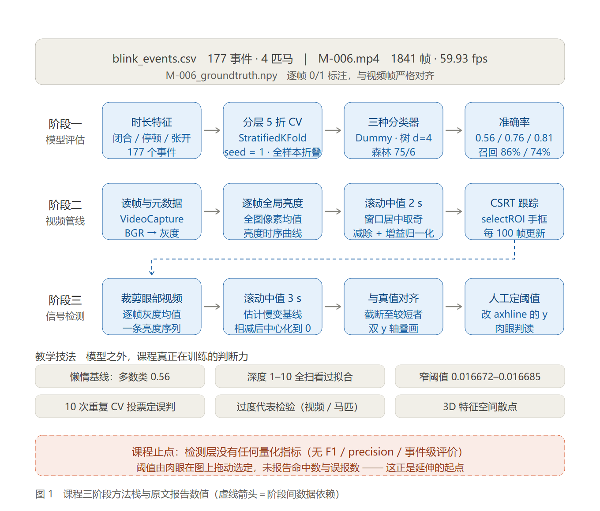
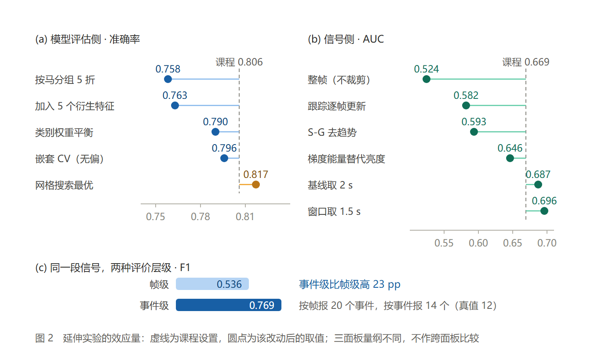

# AI Session 研学项目：眨眼检测的复现与延伸

本目录把 2026 年暑假在 Aberystwyth University 参加的 AI 课程（*Understanding and Improving Machine Learning Models* + *Building a Blink Detection Pipeline*）从"跟着 notebook 点运行"整理成一份可复现、可检验、可延伸的小型研究项目。

---

## 一句话结论

课程做出的是一个81% 准确率的眨眼类型分类器，和一个帧级 AUC 0.67 的亮度眨眼信号。复现后看：分类器的诚实水平是 76–78%（随机分折高估 4.9 pp，调参再高估 2.2 pp），但信号是真实的（置换检验 p = 0.0099）；同一段信号在事件级口径下 F1 达 0.769，比帧级口径 0.536 高 23 个百分点——结论取决于评价口径，这一点比模型本身更值得记住。

---

## 两张总览图

### 图 1　课程本身用了什么



课程是一条**三段式**结构，三段之间只有一处数据依赖（CSRT 裁剪出的眼区视频 → 信号提取）。三条带里标的是课程原文报出的数值；底部两行是**教学技法**（懒惰基线、深度1–10 全扫、窄阈值 `0.016672–0.016685`、10 次重复投票、过度代表检验、3D 散点），以及课程的**止点**：检测层没有任何量化指标。

### 图 2　延伸把分数移动了多少



虚线是课程设置，圆点是该改动后的取值，每个面板有独立量纲。三个面板合起来回答一个问题：**改哪里才真的改变结论**。答案是底部的 (c)——评价层级，而不是上面任何一个模型或参数。

---

## 目录结构

```
project/
├── README.md                     ← 你正在看的文件
├── requirements.txt
├── notebooks/                    ← 交付物：5 个已执行的 notebook（含全部输出）
│   ├── 01_session1_ml.ipynb              Session 1 复现：模型、调参、误差分析
│   ├── 02_session2_video.ipynb           Session 2 复现：视频管线、跟踪
│   ├── 03_session3_signal.ipynb          Session 3 复现：亮度信号与真值对照
│   ├── 04_extension_model_evaluation.ipynb   延伸一：0.81 有多可信
│   └── 05_extension_signal_detection.ipynb   延伸二：从"像"到"能检测"
├── notebooks_src/                ← notebook 的 .py 源码（可 diff、可 lint）
├── src/                          ← 复用模块（notebook 只是薄壳）
│   ├── config.py                 路径、参数、绘图风格（唯一真源）
│   ├── eda.py                    数据加载与探索
│   ├── models.py                 决策树 / 随机森林 / 调参 / 重复 CV
│   ├── errors.py                 误差分析、过度代表检验、特征空间
│   ├── video.py                  视频解码、亮度基线、归一化、CSRT 跟踪
│   ├── blink_signal.py           亮度信号、去趋势、阈值扫描、事件匹配
│   ├── extension_ml.py           延伸（一）的 9 项分析
│   ├── extension_signal.py       延伸（二）的 7 项分析
│   └── pipeline.py               视频管线的可复现入口（带缓存）
├── tools/build_notebooks.py      .py → .ipynb 并执行
├── reports/
│   ├── 复现与延伸报告.md          主报告（含全部结论与数据表）
│   ├── 复现与延伸报告.html        自包含 HTML（图片内嵌，可直接分享）
│   └── figures/                  两张总览图的 PNG + SVG
├── figures/                      ← 43 张实验图，全部由代码生成
├── outputs/                      ← 33 张表（csv）+ 零分布 / 最优参数
└── data/
    ├── crops/                    示例眼区裁片（PNG）
    ├── processed/                跟踪后的眼区视频
    └── roi_signals.npz           逐帧信号矩阵（供快速加载）
```

---

## 环境

```bash
python -m venv .venv
.venv/Scripts/pip install -r requirements.txt      # Windows
# source .venv/bin/activate && pip install -r requirements.txt   # macOS / Linux
```

依赖：`numpy`、`pandas`、`scikit-learn`、`matplotlib`、`scipy`、**`opencv-contrib-python`**（普通 `opencv-python` 不含 CSRT 跟踪器）、`nbformat` / `nbconvert` / `nbclient` / `ipykernel`。

---

## 如何运行

### 1. 先跑视频管线（约 1 分钟，生成缓存）

```bash
cd src
python -m pipeline            # 缺什么算什么
python -m pipeline --force    # 全部重算
```

产物：`outputs/frame_brightness_stats.csv`（逐帧全局亮度）、`outputs/roi_signal_stats.csv`（逐帧跟踪框 + 8 个眼区统计量）、`data/processed/tracked_eye_crop.mp4`、`data/roi_signals.npz`。

### 2. 生成并执行 notebook

```bash
python tools/build_notebooks.py --execute            # 全部（约 8 分钟）
python tools/build_notebooks.py --execute 01_session1_ml   # 单个
```

notebook 由 `notebooks_src/*.py` 生成，**不要直接编辑 .ipynb**——改了会被覆盖。

### 3. 只想要结果

直接看 `notebooks/` 里已执行好的 notebook，或读 `reports/复现与延伸报告.html`。

---

## 课程用了哪些方法

课程的方法清单很克制：**两个分类器 + 三个图像处理步骤，没有神经网络**。全部是经典、
可解释的方法。数据是 186 个眨眼事件（105 全 / 81 半）、19 段视频、4 匹马。

### 阶段一　模型评估（`ai_session1.ipynb`）

| 环节 | 方法 | 具体设置 | 课程结果 |
|---|---|---|---|
| 基线 | `DummyClassifier(strategy="most_frequent")` | 永远猜多数类 | 0.5645 |
| 模型一 | `DecisionTreeClassifier` | 深度 1–10 全扫，选 depth=4 | 0.76 |
| 模型二 | `RandomForestClassifier` | 先 100 棵/深度 10，再 3×5×4=60 组网格，选 75/6 | **0.8118** |
| 划分 | `StratifiedKFold(5, shuffle=True)` + `cross_val_predict` | 固定 `random_state=1` | — |
| 指标 | `accuracy_score`、`ConfusionMatrixDisplay`、按类 `recall_score` | F/H 分别算 | F 86% / H 74% |
| 稳定性 | 重复 10 次 CV（每次换 seed） | mean ± sd | 0.80 ± 0.01 |

课程真正的教学重点不在模型，而在**怎么读懂模型**：把 depth=1/4/10 的树画出来对比叶节点数，用可视化讲"过拟合长什么样"；在 depth=10 的树里找出`0.01667223 < paused_duration <= 0.01668474` 这种**只装得下一个样本的切分**作为物证；用 10 次重复的票数定义"稳定误判"（`times_incorrect > 5`，36 个事件）；再做**过度代表检验**（问题样本数 vs 按比例应得数之差），按 `video_id` 与 `Horse_ID` 分组看错误是否集中在某几段视频或某匹马。

### 阶段二　视频管线（`ai_session_2.ipynb`）

| 步骤 | 方法 |
|---|---|
| 读帧与元数据 | `cv2.VideoCapture` → frame_count / fps / 分辨率 |
| 转灰度 | `cv2.COLOR_BGR2GRAY`，逐帧写入新视频（`VideoWriter` + `mp4v`） |
| 全局亮度 | 每帧所有像素 `.mean()` |
| 基线估计 | **滚动中值**，窗口 2 s 换算成帧、强制奇数、`center=True`、`min_periods=1` |
| 去趋势 | 亮度 − 滚动基线 |
| 亮度归一化 | 以基线中位数为 `reference_brightness`，逐帧乘增益抵消曝光漂移 |
| 目标跟踪 | **CSRT**，`cv2.selectROI` 手框眼睛，**每 100 帧才更新一次**跟踪器 |

### 阶段三　信号检测（`final_session.ipynb`）

| 步骤 | 方法 |
|---|---|
| 提信号 | 裁剪视频逐帧灰度均值 → 一条亮度序列 |
| 基线校正 | 滚动中值 **3 s** 窗口，相减 |
| 对齐 | 截断到较短者，与 `M-006_groundtruth.npy` 双 y 轴叠画 |
| 判读 | 局部放大（750–1000 帧）看单个眨眼波形 |
| 定阈值 | **人工**：取消注释 `ax1.axhline(y=0)`，自己改 y 值，肉眼看哪个高度分得最开 |

### 课程没做的

不做的部分都是"课堂提问"而非"课堂实现"，这正是延伸的入口：

- **没有任何检测量化指标**。PDF 原文是"改一下 y 值，找出最好的阈值，说说它正确和错误识别了多少个眨眼"——全靠肉眼，没有 F1 / precision / 事件级的任何概念。
- **没有分组 CV**，所以"同一匹马"的泄漏无从察觉；`Horse_ID` 只用于事后错误归因。
- **没有嵌套 CV / 置换检验**，网格搜索出来的 0.8118 被直接当成性能。
- **没有特征重要性**（`feature_importances_` 一次都没调用），只有单变量直方图。
- **没有换过统计量**（只用 mean）、**没有比较过去趋势方法**（只用滚动中值）、**没有比过整帧 vs 眼区**（直接跳到裁剪）。
- 单视频、单马（M-006），`frame_step=100` 也没给依据。

---

## 复现范围与结果对照

完整对照表见报告第 2 节。关键条目：

| 课程结果 | 课程值 | 复现值 | |
|---|---|---|---|
| 事件数 / 视频 / 马匹 | 186 / 19 / 4 | 186 / 19 / 4 | ✅ |
| 多数类基线 | 0.56 | 0.56 | ✅ |
| 决策树（depth 4） | 0.76 | 0.76 | ✅ |
| 随机森林最优（75/6/1） | 0.8118 | 0.8118 | ✅ |
| 召回率 决策树 F/H | 76% / 80% | 76% / 80% | ✅ |
| 召回率 随机森林 F/H | 86% / 74% | 86% / 74% | ✅ |
| 重复 10 次 CV | 0.80 ± 0.01 | 0.80 ± 0.01 | ✅ |
| 视频元数据 | 1841 帧 / 59.93 fps / 30.72 s | 完全相同 | ✅ |
| 参考亮度 | 112.38 | 112.38 | ✅ |

差异都是**有意的工程改进**，不是结果不一致：

1. **ROI 固化**：课程用 `cv2.selectROI` 手动拖框，结果因人而异、无法复现；本项目把框固定为 `(250, 470, 640, 560)`。
2. **不落盘中间视频**：课程的灰度/归一化视频合计约 265 MB，本项目边归一化边跟踪，只保留标量与 28 MB 眼区裁片（数值一致）。
3. **3D 图**：课程用 plotly 交互图，本项目用 matplotlib 静态图 + 两两投影图，便于嵌入报告。

---

## 延伸一：0.81 有多可信（`04_extension_model_evaluation.ipynb`）

方向是**质疑"分数"本身**——不问"能不能更高"，而问"这个数字站不站得住"。

| 编号 | 分析 | 结果 |
|---|---|---|
| E1 | 六个模型同口径对比 | RF 0.8065 / 树 0.7796 / kNN 0.7581 / SVM 0.7366 / LR 0.7312 / 多数类 0.5645；AUC 树 0.862 ≈ RF 0.869 |
| E2 | **按马分组 CV** | 分层 0.8063 → StratifiedGroup 0.7764 → Group 0.7577，泄漏约 **4.9 pp** |
| E3 | 置换检验（100 次打乱） | 零分布 0.523 ± 0.039，观测 0.806，**p = 0.0099** |
| E4 | 嵌套 CV | 选择偏差 0.8172 vs 诚实 0.7956，乐观 **2.2 pp** |
| E5 | 特征集消融（3/4/6/8 维） | 原始 3 维最好 0.7993；加任何派生特征都掉到 0.76–0.77 |
| E6 | 置换重要性 | `paused_duration` 0.133 遥遥领先；`total_duration` 0.053；`close_open_ratio` 仅 0.008 |
| E7 | 学习曲线 | 训练 0.99 → 0.91，验证 0.650 → 0.806 **仍在上升，未见平台** |
| E8 | 类别权重 | 平衡后 0.7903 < 0.8065，56/44 的不平衡**不需要处理** |
| E9 | 置信度分层 | 置信 ≤0.2 时错误率 **39%**，>0.8 时仅 6.3%——可用于弃权/人工复核 |

有两条反直觉的：派生特征全部有害（总时长、比率都是原特征的确定性函数，树会把它们当成新的切割轴，在 186 个样本上纯增方差）；瓶颈是数据不是模型（学习曲线仍在爬升，换更复杂的模型没有意义）。

---

## 延伸二：从"像"到"能检测"（`05_extension_signal_detection.ipynb`）

方向是**逐环节质询管线**——课程每一步都可以问"这步真的有用吗、有没有更好的"。

| 编号 | 分析 | 结果 |
|---|---|---|
| S1 | 8 种图像统计量 | median 0.671 / mean 0.669 / 梯度能量 0.646 / 下眼睑 0.557 / 对比度 0.474 |
| S2 | 基线窗口 0.5–8 s 扫描 | **1.5 s 最优 0.696**，课程的 3 s 为 0.669，8 s 掉到 0.636 |
| S3 | 6 种去趋势方法 | 滚动中值 2 s 0.687 最好；S-G 0.593、Butterworth 0.599、一阶差分 0.583；**完全不去趋势也有 0.646** |
| S4 | 平滑消融 0–0.5 s | 0–0.2 s 事件 F1 恒为 **0.769**（平滑无收益），0.5 s 反而掉到 0.667 |
| S5 | 跟踪更新步长 1/10/50/100 | **逐帧最差**：漂移 493 px、AUC 0.582；100 帧最好 0.669 |
| S6 | 全帧亮度 vs 眼区亮度 | 0.524（≈随机）vs 0.669——**裁剪是前提，不是优化** |
| S7 | 阈值选择准则 | 按帧 F1 选 → 阈值 0.258、事件 F1 0.625、报 20 个事件；按事件选 → 阈值 0.621、事件 F1 0.769、报 14 个（真值 12） |

三个关键解释：

- **课程那步时序滤波被高估了**。眨眼是"低频宽事件"，Butterworth 高通和 S-G 反而削弱了它本身；平滑（S4）几乎不改变结果。
- **逐帧更新跟踪器是陷阱**。CSRT 的外观模型会被眨眼本身（眼睑遮住眼球）污染，越更新越偏，漂移 493 px；每 100 帧更新一次反而最稳。
- **按帧选阈值会系统性多报**。同一个信号，帧级 F1 0.536 vs 事件级 0.769；错误准则让你报出 20 个事件而不是 14 个。

---

## 把 16 个实验放在一起看

| 改什么 | 改变前 → 改变后 | 幅度 |
|---|---|---|
| 换模型（LR → RF） | 0.7312 → 0.8065 | +7.5 pp |
| 换切分（分层 → 按马分组） | 0.8063 → 0.7577 | **−4.9 pp** |
| 加派生特征（3 → 8 维） | 0.7993 → 0.7634 | −3.6 pp |
| 调参（嵌套 → 网格最优） | 0.7956 → 0.8172 | +2.2 pp（**是偏差**） |
| 换统计量（mean → median） | 0.669 → 0.671 | +0.2 pp |
| 换 ROI（整帧 → 眼区） | 0.524 → 0.669 | +0.145 AUC |
| **换评价层级（帧级 → 事件级）** | 0.536 → 0.769 | **+23 pp** |

在这个小样本、强分组、标签不完整的场景里，"怎么评价"比"用什么模型"重要得多。换模型只能挪动 1–7 个百分点，而换切分方式、换评价层级、换阈值准则，每一项都能让结论翻转。

---

## 已知局限

1. **单视频**：所有视频结论都来自 M-006（1841 帧，12 次眨眼），管线没有跑遍 19 段视频。没有置信区间，换个体的光照绝对值和阈值都会变。
2. **阈值在真值上调出**：属于样本内结果，部署效果会更低。
3. **真值主观**：全/半眨眼边界是人的判断（课程开场让大家自己数就在演示这件事），构成标签噪声上限。
4. **分类部分与视频部分没有打通**：`blink_events.csv` 没有帧号，无法把视频信号与具体事件的标签对上。
5. **单次划分的 CV 结果带随机性**：本项目用固定 seed 保证可复现，但没有做多次划分的区间估计（E2 的 0.7764 与 0.7577 之间就有 fold 级的抖动）。

---

## 后续可做

按性价比排序：

1. **拿到带帧号的原始标注**，打通「视频信号 ↔ 事件标签」，才能验证"半眨眼亮度变化是否更小、更短"这类跟随课程的假设。
2. **把管线跑遍 19 段视频 / 4 匹马**，给 S1–S7 的结论补上跨个体分布（现在全是 n=1）。
3. **按 S1 的提示把 ROI 下裁**（下眼睑统计量 0.557，几乎无信息），再重测一次。
4. **用 S7 的事件级准则重做阈值选择**，并把帧级指标从报告里降级为辅助信息。
5. 若要继续做检测：用 1-D 卷积或简单的峰值检测替代阈值法，并在事件级评估。
