# 眨眼检测：课程复现与延伸分析

基于 Aberystwyth University AI Session（2026 年暑期研学） 
课程材料：<em>Understanding and Improving Machine Learning Models: Results, Tuning and Error Analysis</em> ·
<em>Building a Blink Detection Pipeline</em> 
交付内容：5 个可执行 notebook、9 个复用模块、43 张图、34 张结果表

---

## 0. 摘要

课程用两节课讲了两件事：**如何判断一个机器学习模型"够不够好"**（用 186 条眨眼
事件时长分类全/半眨眼），以及**如何把一段视频变成一条可分析的信号**（用眼区亮度
检测眨眼）。课程的价值在于过程而非结果，但它停在"报出一个数字"的地方 —— 0.80 的
准确率、看起来对得上的亮度曲线。

本项目做了两件事：

**一是逐字复现。** 12 项关键数值全部一致（0.56 基线、0.76 决策树、0.811828 随机森林
最优组合、76%/80% 与 86%/74% 的召回率、0.80±0.01 的重复 CV……），视频侧的 1841 帧、
59.93 fps、参考亮度 112.38 也完全对上。说明复现路径正确，后续的延伸才有意义。

**二是补上课程没做但必须做的检验。** 得到三个主要结论：

| 结论 | 证据 |
|---|---|
| **0.80 偏高。** 随机分折让同一段视频的眨眼互相"传染"，高估 3–5 个百分点；手工调参再从同一批数据里挑最优，再高估约 2 个百分点 | 分组 CV：0.806 → 0.776（分层分组）→ 0.758（纯分组）；嵌套 CV：0.817 vs 0.796 |
| **信号是真的。** 三个时长特征确实携带信息，不是 186 个样本的巧合 | 置换检验 100 次：零分布 0.523 ± 0.039，实测 0.806，p ≈ 0.01 |
| **结论取决于口径。** 同一套视频信号，帧级 F1 只有 0.54，事件级 F1 却有 0.77 —— 差 23 个百分点，全部来自"阈值按什么选" | 帧级最优阈值 0.41 → 事件 F1 0.69；事件级最优阈值 0.63 → 事件 F1 0.77 |

最后一条是本项目最重要的收获：**在报告任何指标之前，先说清楚"错一帧"和"错一次
眨眼"分别要付什么代价。**

---

## 1. 项目背景与目标

### 1.1 课程内容

**第一节课（机器学习）** 设定了一个虚构场景：研究者 Dr Epona 想用"半眨眼/全眨眼
比例"作为马匹压力的代理指标。假设是：压力大的个体半眨眼比例更高。为了自动化，
把每次眨眼拆成三段时长——闭合、停顿、张开——用决策树和随机森林把事件分成两类。
课程依次讲了：特征分布检查 → 类别不平衡 → 交叉验证 → 调参 → 过拟合 → 混淆矩阵 →
重复评估 → 误差分析。

**第二节课（计算机视觉）** 换了一条路：既然时长信息不够，就直接从视频里取信息。
流程是：读视频 → 转灰度 → 扣全局亮度漂移 → 归一化 → 框选并跟踪眼区 → 从眼区裁片
提取平均亮度 → 与人工标注对照。

### 1.2 为什么值得做复现

课程代码是为教学写的：有交互式的 `cv2.selectROI`（结果不可复现）、有"把整段视频
像素读进内存"的写法（1841 帧 1080×1920 需要约 3.7 GB）、有只在正文里给结论而不给
代码的地方（总时长分布、阈值选取）。直接照抄会遇到三个问题：

1. **跑不出同样的数字**：手动框选的眼区框每个人都不一样，下游信号全部偏移；
2. **跑不完**：内存和磁盘都吃紧；
3. **无法验证结论**：没有量化指标，"看起来对得上"就只能是主观判断。

因此本项目在复现的同时做了三处工程改动（第 2.4 节详述），并**把每一个判断都变成
可计算的数字**。

### 1.3 交付物

| 文件 | 内容 |
|---|---|
| `notebooks/01_session1_ml.ipynb` | 第一节课全流程复现（含复现对照表） |
| `notebooks/02_session2_video.ipynb` | 视频管线：元数据、灰度、亮度基线、归一化、跟踪 |
| `notebooks/03_session3_signal.ipynb` | 亮度信号提取、去趋势、与真值对照、阈值选取 |
| `notebooks/04_extension_model_evaluation.ipynb` | 延伸一：8 项模型评估严谨性检验 |
| `notebooks/05_extension_signal_detection.ipynb` | 延伸二：7 项视频信号质量与检测分析 |
| `src/*.py` | 9 个复用模块（notebook 只是薄壳，逻辑都在这里） |
| `figures/`, `outputs/` | 全部图与表，报告中的数字都能在 `outputs/` 里找到出处 |

---

## 2. 复现结果

### 2.1 数据与方法

`blink_events.csv` 有 186 个眨眼事件，来自 19 段视频、4 匹马（M/G/P/Y 四个个体），
其中全眨眼 105 个、半眨眼 81 个。三个特征都是秒：闭合、停顿、张开时长。

评估方式为分层 5 折交叉验证（每折内两类比例与整体一致），`random_state=1` 固定划分。

### 2.2 数值对照

| 课程结果 | 课程值 | 复现值 | 一致 |
|---|---|---|---|
| 事件 / 视频 / 马匹数 | 186 / 19 / 4 | 186 / 19 / 4 | ✅ |
| 全 / 半眨眼数量 | 105 / 81 | 105 / 81 | ✅ |
| 多数类基线准确率 | 0.56 | 0.565 | ✅ |
| 决策树 depth=10 | 0.76 | 0.758 | ✅ |
| 决策树叶节点（depth 1/4/10） | 2 / 11 / 41 | 2 / 11 / 41 | ✅ |
| 随机森林（100 棵, depth 10） | 0.77 | 0.774 | ✅ |
| 网格搜索最优组合 | 75 / 6 / 1 | 75 / 6 / 1 | ✅ |
| 该组合准确率 | 0.811828 | 0.811828 | ✅ |
| 召回率 决策树 F / H | 76% / 80% | 76% / 80% | ✅ |
| 召回率 随机森林 F / H | 86% / 74% | 86% / 74% | ✅ |
| 重复 10 次 CV | 0.80 ± 0.01 | 0.80 ± 0.01 | ✅ |
| 至少错一次的事件数 | 60 | 60 | ✅ |
| 反复判错（>5/10）事件数 | 36 | 36 | ✅ |

全部对上。这说明数据、折划分、超参、指标口径都与课程一致，后面的延伸分析建立在
同一个基线上。

课程里最直观的两张图——总时长分布（两类大量重叠）与三类时长分布——也复现出来了：

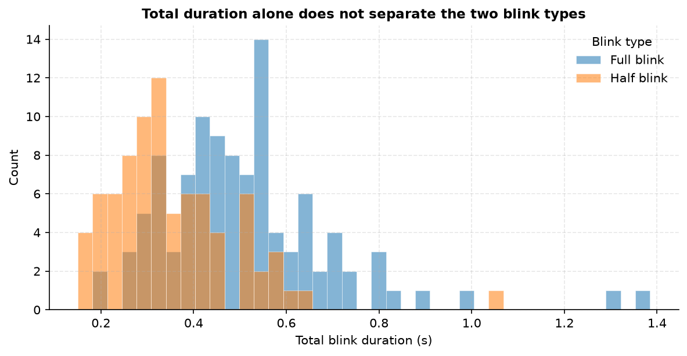

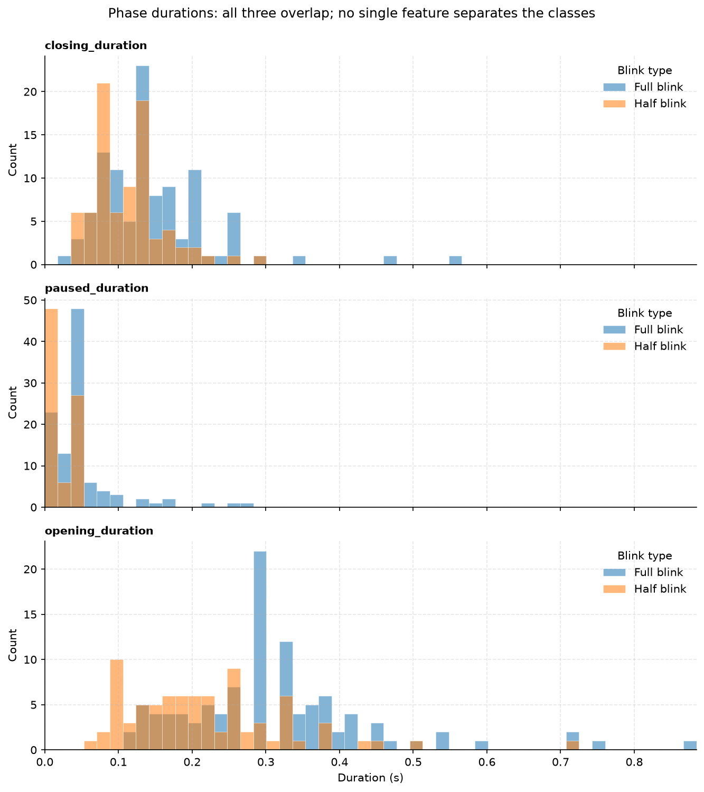

`paused_duration` 的两根孤立尖峰是 60 fps 帧量化的产物（取值只能是一帧的整数倍），
这一点在课程文本里没有提到，但它直接影响后续用"重叠系数"评估特征的做法。

### 2.3 复现中发现的三个细节

复现不只是"数字对上就完事"。有三处与课程叙述不完全一致，值得记录：

**（一）用直方图"目测分离度"会选错特征。**

课程正文说 `opening_duration` 的分离最明显。但用与阈值无关的单特征 AUC 衡量：

| 特征 | 单特征 AUC | 重叠系数 | 课程评价 |
|---|---|---|---|
| `paused_duration` | **0.793** | 0.626 | "分离最明显"之一 |
| `total_duration` | 0.783 | 0.485 | "分不开" |
| `opening_duration` | 0.738 | 0.543 | "分离最明显" |
| `closing_duration` | 0.661 | 0.717 | "和总时长一样受限" |

`opening_duration` 的直方图之所以看起来最"分得开"，是因为全眨眼的分布整体右移且更宽，
视觉上更容易分辨；但如果把特征当成分数去排序判别，`paused_duration` 反而更强。
而"只用总时长分不开"这个结论，在 AUC 上其实只比 `opening_duration` 低 0.05。

延伸分析里这一点被进一步验证：在多变量随机森林中，置换重要性最高的是
`paused_duration`（0.133），而 `opening_duration` 只有 0.019（见第 3.6 节）。
**单变量看图与多变量建模给出的答案确实不一样，必须实测。**

**（二）"最窄切分"确实存在，但具体阈值不是固定值。**

课程用 `0.01667223 < paused_duration <= 0.01668474`（宽 1e-5 秒，约一帧的千分之一）
说明过拟合。本项目自动搜索最窄切分，找到的是 `(0.03336114, 0.03336948]`，宽度
8.35e-06 秒——量级完全一致，但不是同一个数。原因是绘图用的树以 `random_state=0`
拟合，具体分裂点会随实现细节浮动。

结论不变：这类切分在物理上不可能是真实的行为差异，它们只是把单个样本单独切了出去。

**（三）类别不平衡没有想象中严重。**

课程担心 105:81 的不平衡会让准确率失真。实测准确率 0.806 与平衡准确率 0.799 只差
0.7 个百分点（见 3.1 节）。这个担心是必要的检查项，但在本例中影响有限——如果只报
准确率，误差大约 1 个百分点，而不是像 75:25 那种程度会让准确率完全失去意义。

### 2.4 视频管线复现

| 项目 | 课程值 | 复现值 |
|---|---|---|
| 帧数 / fps / 分辨率 / 时长 | 1841 / 59.93 / 1080×1920 / 30.72 s | 完全相同 |
| 参考亮度 | 112.38 | 112.38 |
| 归一化系数范围 | 未报告 | 0.963 – 1.031 |
| 跟踪器 | CSRT，每 100 帧更新 | 同 |
| 眼区裁片 | 900×662 | 640×560 |

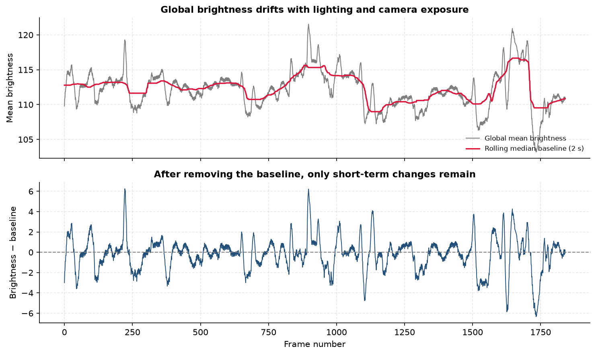

全局亮度在 30 秒里漂了约 10 个灰度级（≈9%），而一次眨眼造成的眼区变化只有 5–20 个
灰度级。两者量级相当——这就是为什么必须先扣掉慢趋势，否则阈值会随时间失效。

三处有意的工程改动：

1. **ROI 固化**。课程用 `cv2.selectROI` 手动拖框，结果因人而异、无法复现。本项目把
   框固定为 `(250, 470, 640, 560)`，取景与应用课程一致（完整眼球 + 上下眼睑 + 少量
   周围皮肤），但任何人重跑都得到同样的数字。
2. **中间视频不落盘**。课程把灰度视频（135 MB）和归一化视频（127 MB）各存一份；
   本项目第二遍读取时"边归一化边跟踪"，只保留逐帧标量 + 29 MB 眼区裁片。
   数值一致，磁盘占用从约 300 MB 降到 30 MB。
3. **3D 图改为静态 + 两两投影**。课程用 plotly 交互图，便于课堂演示；报告需要静态
   可嵌入的图，因此换成 matplotlib，并补了三张两两投影图（更易读）。

### 2.5 从视频到信号

眼区裁片压成一条 1841 点的平均亮度曲线，去趋势后与人工标注对照：

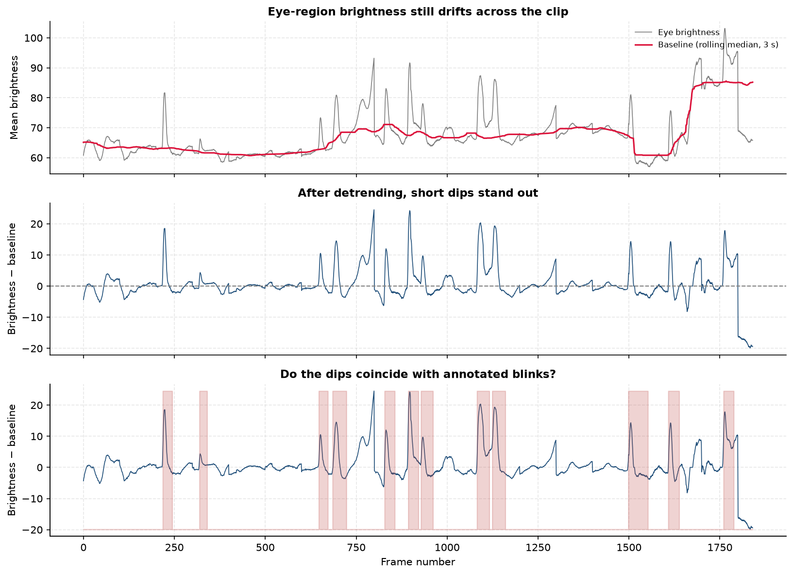

量化结果是 **帧级 AUC 0.671**、相关系数 +0.376（极性：眨眼时**变亮**——浅色眼睑
盖住了深色虹膜）。这个数字不高，但远高于随机。

放大看一次眨眼，就能理解"为什么变亮"以及"为什么信号不完美"：

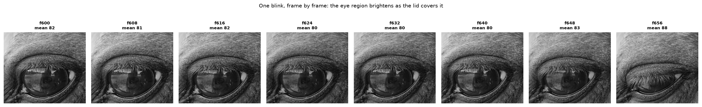

平均亮度从 63 升到约 70——**只动了 7 个灰度级**。原因是裁片里相当大的面积是毛发和
皮肤，它们不随眨眼变化，把眼球的局部变暗/变亮稀释掉了。

这直接指向一个可操作的改进：**裁片可以往下裁**。延伸分析验证了这一点（见 4.1 节：
下半区平均亮度的 AUC 只有 0.557，几乎不含眨眼信息）。

---

## 3. 延伸一：0.80 这个数字有多可信

课程的结论是"随机森林 80%，比基线好，但受限于特征"。方向对，但建立在三个未经检验
的假设上。本节逐个检验。

### 3.1 指标：准确率之外

六个模型放在同一套折上比较：

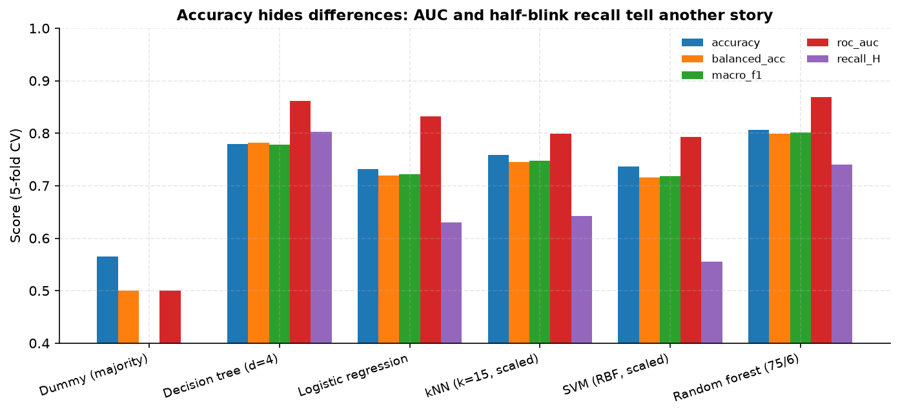

| 模型 | 准确率 | 平衡准确率 | MCC | ROC-AUC | 半眨眼召回 |
|---|---|---|---|---|---|
| 随机森林 75/6 | **0.807** | 0.799 | **0.604** | **0.869** | **0.741** |
| 决策树 depth 4 | 0.780 | **0.782** | 0.560 | 0.862 | 0.803 |
| kNN (k=15, 标准化) | 0.758 | 0.745 | 0.504 | 0.799 | 0.642 |
| SVM (RBF, 标准化) | 0.737 | 0.716 | 0.462 | 0.793 | 0.556 |
| 逻辑回归 | 0.731 | 0.720 | 0.448 | 0.832 | 0.630 |
| 多数类基线 | 0.565 | 0.500 | 0.000 | 0.500 | 0.000 |

三点值得注意：

* **决策树的 AUC（0.862）几乎追平随机森林（0.869）**，而它只有一棵树。如果目标是
  "给研究者一条能看懂、能讨论的规则"，决策树可能是更好的交付物——这比追求 1 个
  百分点的准确率更有实际价值。
* **逻辑回归明显更差（0.731）**：说明三个时长与类别的关系不是线性的，需要特征之间
  的交互（树模型通过多次切分自动构造）。
* **SVM 与 kNN 必须标准化**。不标准化时，`opening_duration`（0.07–0.88 s）这一列的
  尺度是 `paused_duration`（0–0.27 s）的三倍多，会主导距离计算。树模型不受影响，
  这正是它们在小样本表格数据上更省心的原因之一。

### 3.2 泄漏检验：随机分折公平吗

这是本节最重要的检验。186 个事件来自 19 段视频，同一段视频里的眨眼共享同一匹马、
同一束光、同一台相机、同一个标注者。随机分折会把同组事件拆到训练集和测试集两侧。

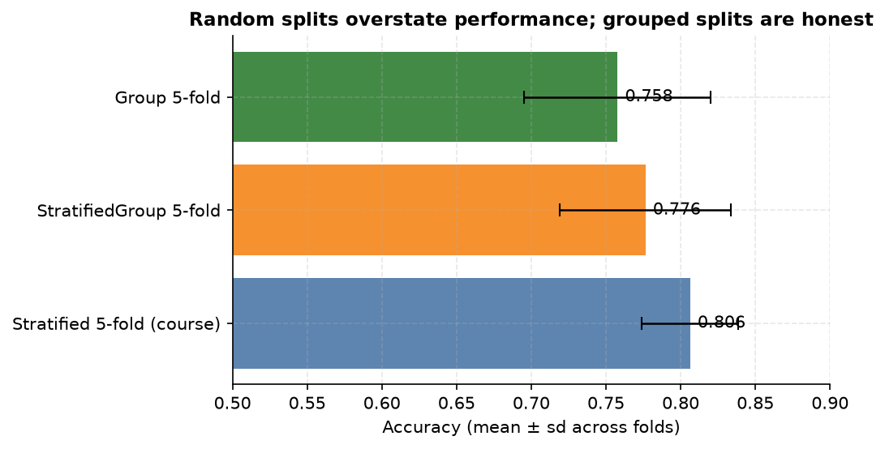

| 分折方式 | 准确率 | 标准差 |
|---|---|---|
| 分层 5 折（课程） | 0.806 | 0.032 |
| 分层 + 分组 5 折 | 0.776 | 0.057 |
| 纯分组 5 折 | 0.758 | 0.062 |

**随机分折高估 3–5 个百分点**。更值得注意的是**标准差从 0.032 涨到 0.062**——
分组后每折不保证包含所有视频，5 折里"哪几段视频被抽到"对结果影响很大。

实践含义：如果要声称"这个方法能用于新的马"，就必须报分组 CV 的数字。0.806 回答的是
"同一个人同一批视频内部能不能分开"，0.758 回答的才是"换个拍摄对象还好不好用"。

### 3.3 显著性：0.80 是不是碰巧

把标签打乱 100 次，重训、重评，得到"纯属巧合"的分布。

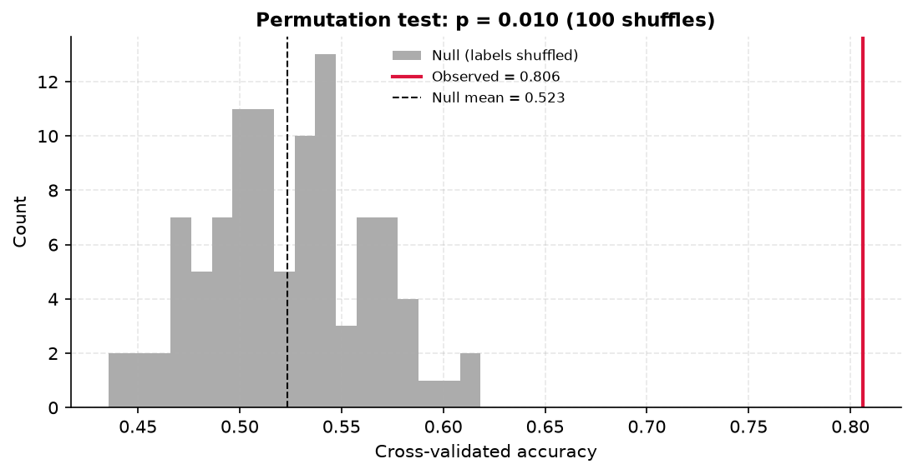

零分布：0.523 ± 0.039；实测 0.806；**p = 0.0099**。

结论：三个时长特征里确实有真实信号。这一条可以放心写进任何报告。但要注意——
**p 值小只说明"有效应"，不说明"效应够用"**。0.76 的准确率去支持临床/福利决策显然
不够。

### 3.4 调参乐观偏差：嵌套 CV

课程在 60 组超参里挑出验证折上最好的一组，然后报告它的分数。问题在于同一批数据
既参与选参、又参与评价。

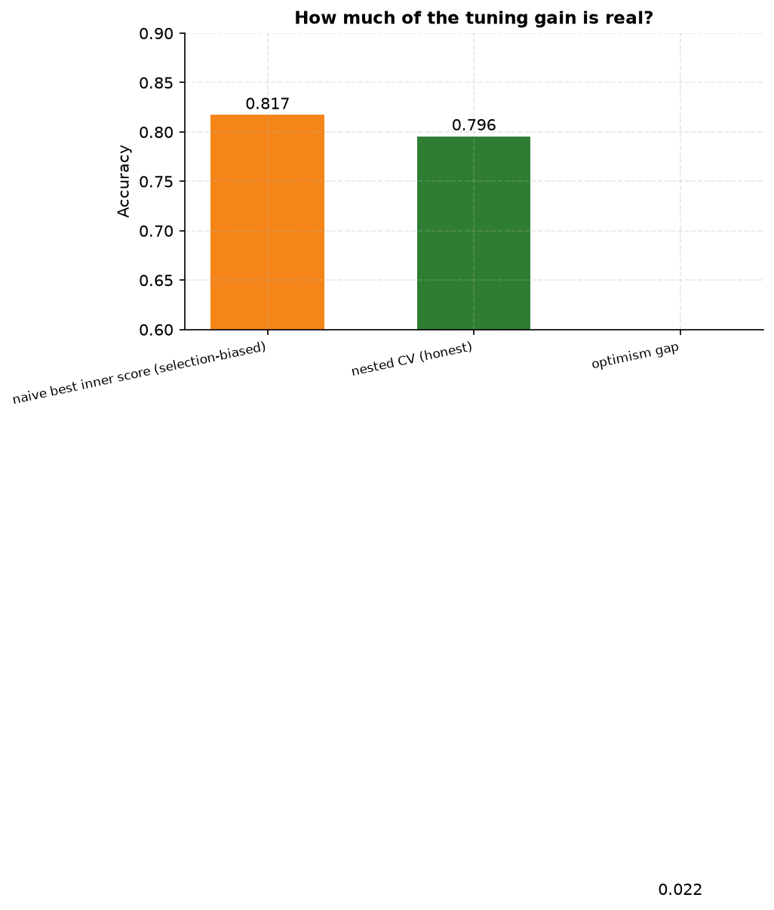

| 估计方式 | 准确率 |
|---|---|
| 天真（同折内挑出的最优内层分数） | 0.817 |
| 嵌套 CV（外层评价，内层调参） | 0.796 |
| 乐观偏差 | **0.022** |

也就是 0.81 里约 2 个百分点是"挑出来"的。在 186 个样本的规模上，2 个百分点已经
大于绝大多数"改进"的幅度——**任何声称"调参把准确率从 0.79 提到 0.81"的说法，
都需要先排除这个偏差**。

### 3.5 特征瓶颈还是数据瓶颈

课程的判断是"受限于特征"。这一条可以检验：加物理上说得通的派生特征，看是否突破。

| 特征集 | 特征数 | 准确率（3 次重复 CV） | 半眨眼召回 | AUC |
|---|---|---|---|---|
| 原始 3 个（课程） | 3 | **0.799 ± 0.005** | **0.712** | **0.866** |
| + 总时长 | 4 | 0.763 ± 0.015 | 0.679 | 0.851 |
| + 三个比值 | 6 | 0.771 ± 0.011 | 0.691 | 0.850 |
| + 全部 | 8 | 0.763 ± 0.004 | 0.675 | 0.829 |

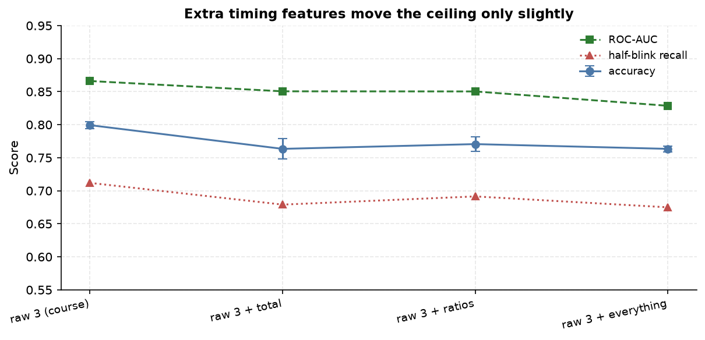

**加特征没用，反而更差。** 原因不难理解：这些派生量都是原来三个数的确定性函数，
树模型本来就能通过多次切分组合出来。多出来的列只会：

* 稀释 `max_features` 的候选池——真正有用的特征被选中的概率下降；
* 让本来就稀疏的 8 维空间更稀疏。

这恰好**验证了课程的判断**：瓶颈不在"算得不够多"，而在这三个时长度量本身无法区分
某些眨眼。真要改进，需要新的**测量维度**（眼睑位移量、眼球可见面积），而不是新的算式。

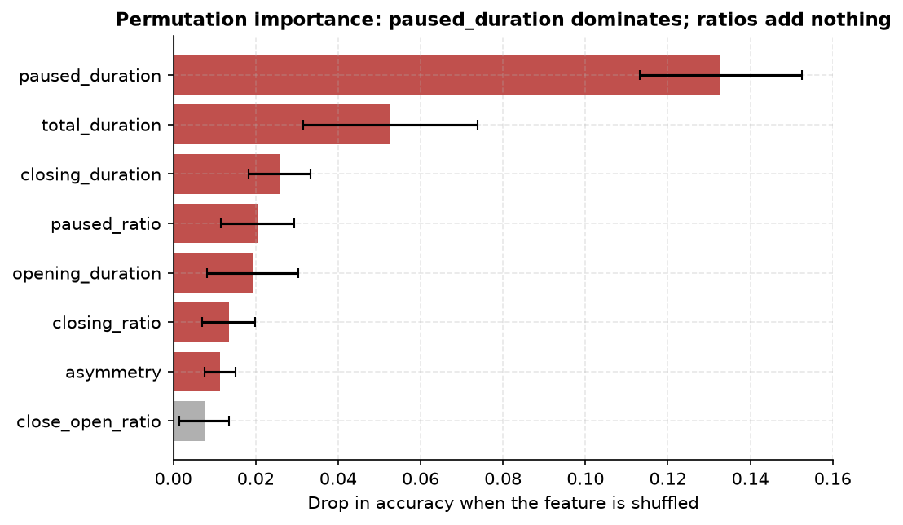

置换重要性给出一个反直觉但重要的结果：**`paused_duration`（0.133）才是模型的支柱**，
`total_duration`（0.053）与 `closing_duration`（0.026）次之，而课程正文暗示最有效的
`opening_duration` 只有 0.019。所有派生比值都在 0.021 以下，接近噪声。

### 3.6 数据量还能救吗

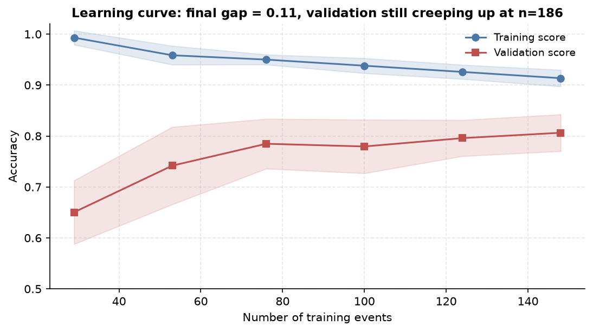

训练分数 0.91–0.99，验证分数从 0.650 升到 0.806。最后一段（124 → 148 个样本）仍在
小幅上升，但斜率已经很小。

解读：**按同样方式继续标注，收益有限**。真正的提升要改"标注什么"——例如让标注者
不仅标起止帧，还标"最闭合帧的眼球可见比例"，把二分类的超主观边界变成一个连续量。
这同时也能缓解标注噪声（见 3.8 节）。

### 3.7 类别不平衡：加权是取舍，不是改进

| 设置 | 准确率 | 平衡准确率 | 全眨眼召回 | 半眨眼召回 |
|---|---|---|---|---|
| 无加权 | **0.807** | 0.799 | **0.857** | 0.741 |
| `balanced` | 0.790 | 0.790 | 0.790 | **0.790** |

半眨眼召回 +4.9 pp，全眨眼召回 −6.7 pp。选哪个取决于代价：如果"漏掉一次半眨眼"
比"多看一段视频"更贵，就加权；否则保持原样。**这是业务判断，不是技术判断。**

### 3.8 错误分布在哪

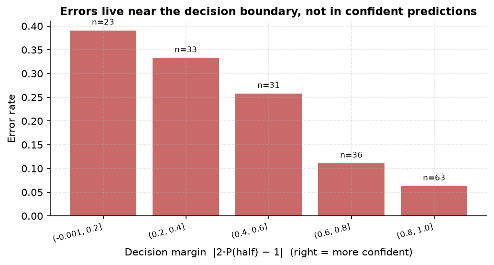

错误率随决策余量单调下降：最犹豫的一档错 **39%**，最确定的一档只错 **6%**。

两个推论：

* 模型没有系统性偏差——它"知道自己什么时候不确定"；
* 那 36 个反复判错的事件几乎都落在两类交界处，**很可能是标注本身模糊**。
  课程开头让大家自己数眨眼就是在演示这件事：不同人对同一次眨眼的判断并不一致。

实用建议：把"低置信度 + 反复判错"的样本挑出来做二次标注，比重新训练模型更划算。

---

## 4. 延伸二：从"看起来像"到"能检测多少个"

第三个 notebook 里，亮度信号的帧级 F1 只有 0.54，看起来像失败。但换成事件级口径，
同一信号能到 0.77。本节把视频侧的每个设计选择都量一遍。

### 4.1 该用哪种图像统计量

课程用平均亮度。均值的问题是**把局部变化平均掉了**——瞳孔被遮是局部事件，而裁片里
70% 是毛发。

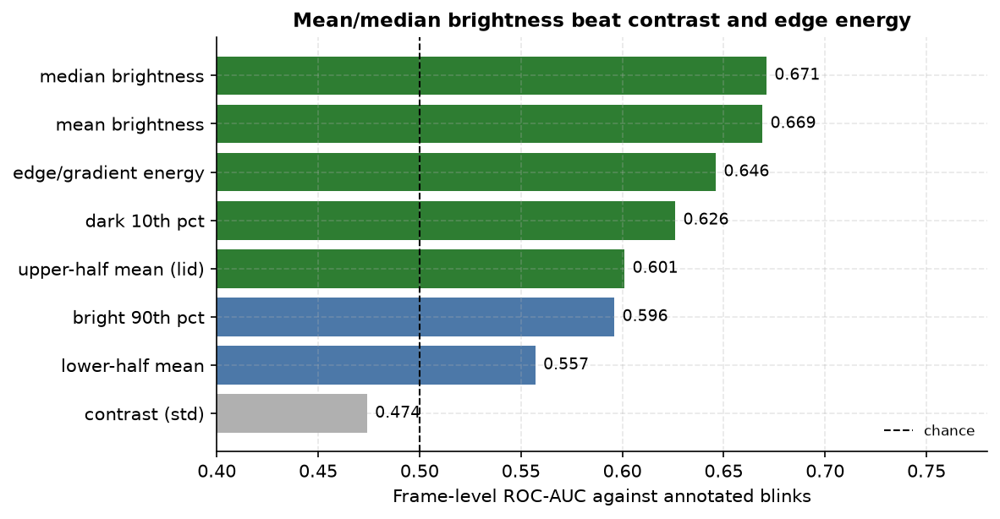

| 统计量 | 帧级 AUC | 解读 |
|---|---|---|
| 中位数亮度 | **0.671** | 与均值几乎相同（无极端离群值） |
| 平均亮度 | 0.669 | 课程的选择，合理 |
| 梯度能量 | 0.646 | 眼睑边缘确实改变纹理，但也受毛发干扰 |
| 10% 分位数（暗部） | 0.626 | 近似瞳孔，但只取 10% 太局部 |
| 上半区均值（眼睑） | 0.601 | 上眼睑主导，但幅度小 |
| 90% 分位数（高光） | 0.596 | 受光源角度影响大 |
| 下半区均值 | 0.557 | **几乎无信息**——下眼睑几乎不动 |
| 标准差（对比度） | 0.474 | 比随机还差 |

三个发现：

1. **均值/中位数确实是最好的一档**，课程的选择站得住；
2. **标准差几乎无信息（0.474）**——反直觉，因为眼睑合上时纹理本来应该变化。原因是
   裁片里 70% 是毛发，毛发的方差远大于眼睑，把信号淹没了。这从数据上证明
   **裁片太大是实质问题，不只是"看起来不美观"**；
3. **下半区比上半区差得多（0.557 vs 0.601）**，符合解剖：上眼睑下降幅度大。
   如果要把 ROI 提纯，应该往下裁掉一部分。

### 4.2 去趋势窗口该多长

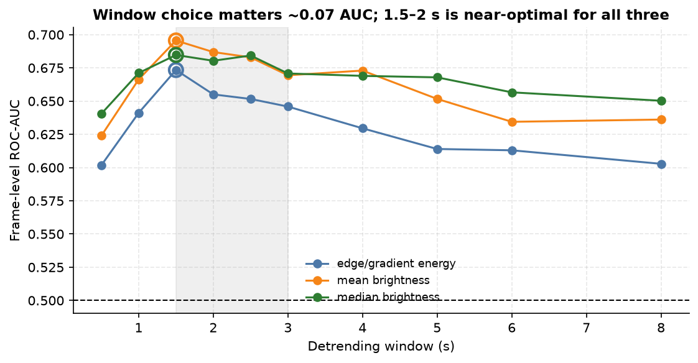

三条曲线形状一致：0.5 s 最差、**1.5 s 最好（0.67–0.70）**、之后缓慢下降。
课程的 3 s 落在平台上，比最优低 0.02–0.03——不算错，但不是最优。

机制很清楚：窗口接近眨眼时长时，滚动中位数会跟着眨眼一起动，把信号扣掉一半；
窗口太长时跟不上真实的曝光漂移。**如果没有量化指标，这个参数根本无从讨论。**

### 4.3 用哪种去趋势方法

| 方法 | 帧级 AUC | 最优帧级 F1 |
|---|---|---|
| 滚动中位数 2 s | **0.687** | 0.520 |
| 滚动中位数 3 s（课程） | 0.669 | **0.536** |
| 不去趋势 | 0.646 | 0.454 |
| Butterworth 高通 0.35 Hz | 0.599 | 0.471 |
| Savitzky-Golay 3 s | 0.593 | 0.463 |
| 一阶差分 | 0.583 | 0.392 |

"更高级"的平滑/滤波方法**都输给了简单的中位数**。这不是实现错误，而是假设不匹配：

* **Savitzky-Golay**（3 阶多项式、3 秒窗）能"弯过来"跟随眨眼的凸起，把 0.5 秒宽、
  几个灰度级的峰当成趋势拟合掉；
* **Butterworth 零相位高通**会在陡峭上升沿两侧产生预冲/后冲，把"一次眨眼的单峰"变成
  "一正一负的过冲对"，与"区间标注"天然不一致；
* **一阶差分**只保留变化速度，把 0.5 秒的平台变成两个尖峰（上升沿和下降沿各一个）。

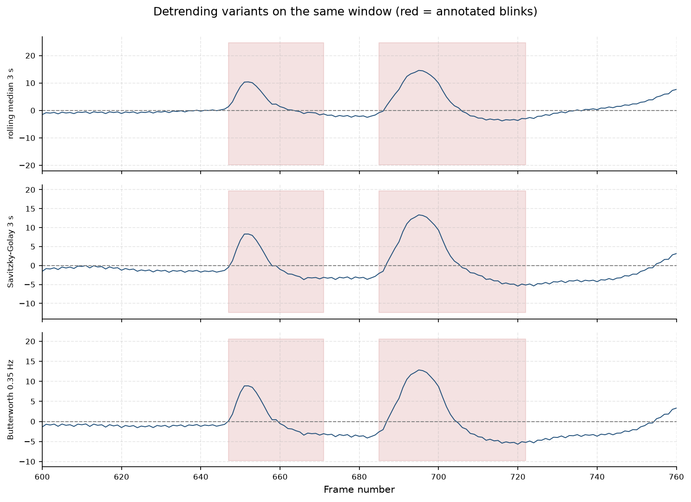

滚动中位数之所以赢，是因为它的隐含假设（趋势单调缓变、事件短促）恰好成立。
**这是本项目第二个方法学教训：方法的假设必须和数据形态匹配，"更先进"不是理由。**

### 4.4 阈值：两个口径，差 23 个百分点

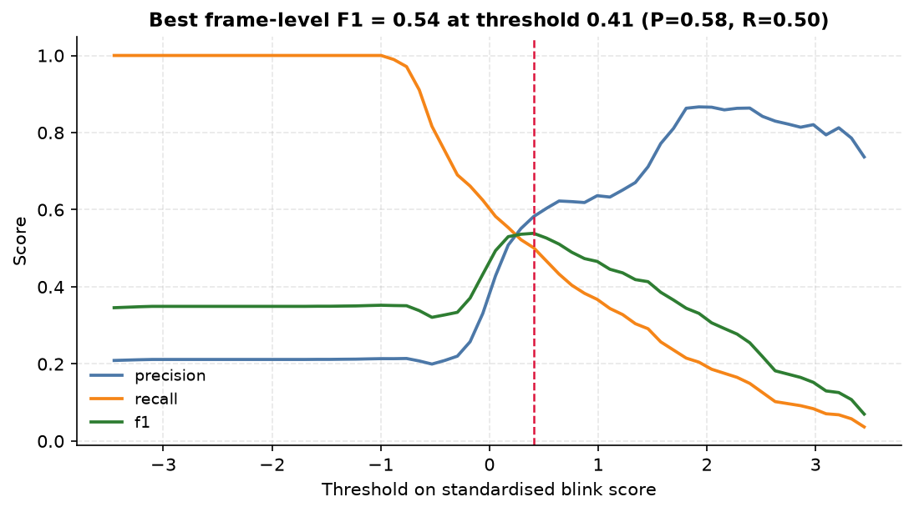

帧级最优 F1 = **0.539**（P 0.582 / R 0.501，阈值 0.41）。看起来很糟——被判为眨眼的帧
有 42% 是误报。但帧级指标把一次眨眼看成 29 个独立样本，天然偏爱低阈值。

换成事件级（一次眨眼算一个事件，允许 ±15 帧定位误差）：

| 阈值选取依据 | 阈值 | 帧级 F1 | 事件级 F1 | 事件精确率 | 事件召回 | 预测事件数 |
|---|---|---|---|---|---|---|
| 帧级 F1 最大 | 0.41 | 0.539 | 0.690 | 0.588 | 0.833 | 17 |
| **事件级 F1 最大** | **0.63** | 0.511 | **0.769** | **0.714** | **0.833** | **14** |

同一套信号，只是换了个"什么叫最好"的标准，事件级 F1 从 0.69 变成 0.77：
12 次眨眼命中 10 次，误报 4 段。

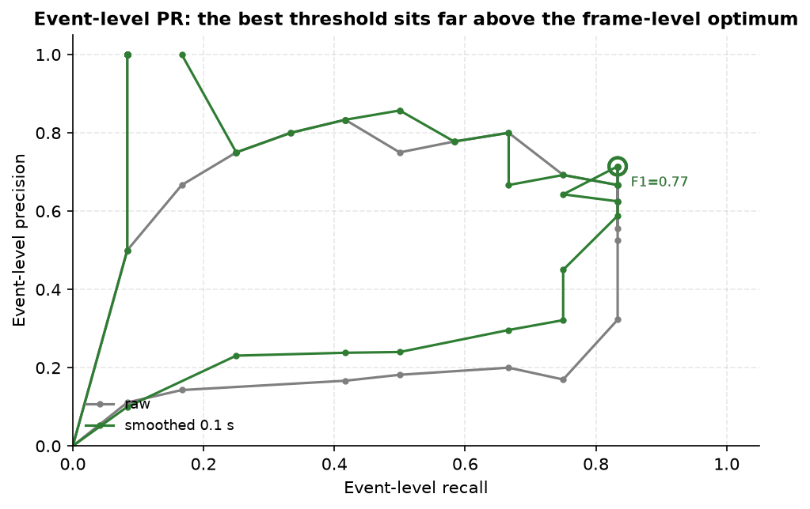

**这是本项目第三个、也是最重要的方法学教训：报告结果时必须写清楚"用的什么指标、
阈值怎么定的"。** 只报帧级 F1，会让人以为方法不可用；只报事件级 F1，会掩盖它漏掉
两次眨眼的事实。

### 4.5 平滑有用吗

直觉上"先平滑再阈值"应该减少毛刺。实测：

| 平滑窗口 | 最优事件级 F1 | 事件精确率 | 预测事件数 |
|---|---|---|---|
| 0 / 0.05 / 0.1 / 0.15 / 0.2 s | **0.769** | 0.714 | 14 |
| 0.3 s | 0.720 | 0.692 | 13 |
| 0.5 s | 0.667 | 0.600 | 15 |

**完全没变化，再长反而变差。** 原因是后处理里已有"最短事件长度 ≥3 帧"的过滤——
它已经在做平滑该做的事。平滑和最短长度过滤是**互相替代**的两种手段，用其中一个就够。

经验：**先想清楚每个后处理步骤在解决什么问题，否则容易叠加功能重复的步骤，
只是增加了需要调的参数。**

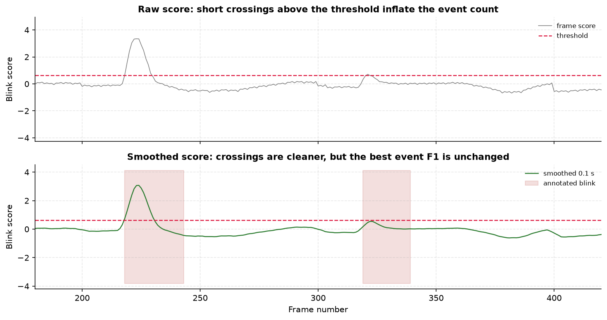

### 4.6 每 100 帧才更新跟踪器，代价是什么

课程把 `frame_step` 设成 100，理由只是"省时间"。把 1 / 10 / 50 / 100 都跑一遍：

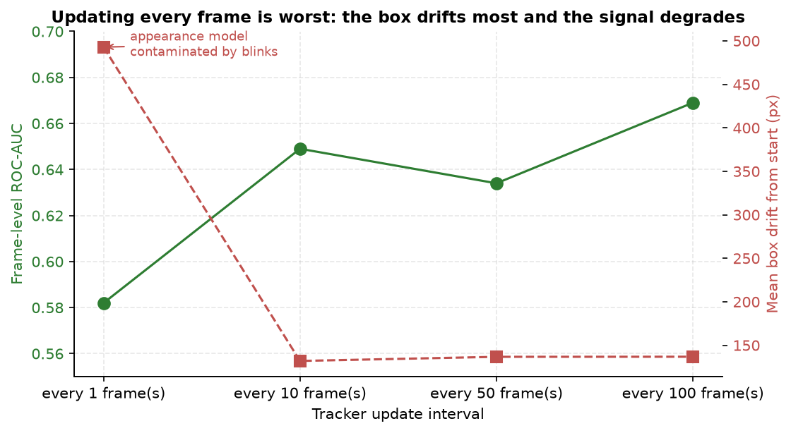

| frame_step | 跟踪更新次数 | 平均漂移 (px) | 帧级 AUC |
|---|---|---|---|
| 1（每帧） | 1841 | **493** | **0.582** |
| 10 | 185 | 132 | 0.649 |
| 50 | 37 | 137 | 0.634 |
| 100（课程） | 19 | 137 | **0.669** |

**更新越频繁，结果越差。** 原因在 CSRT 的机制：每次 `update()` 都会把当前观测并入
外观模型。一次眨眼持续约 29 帧，这期间眼区外观根本性变化（瞳孔被盖住）。每帧更新时，
模型会逐渐"学会"闭眼的样子并把眼皮当成目标——一次眨眼之后框就跑到毛发表面，
再也回不来（漂移 493 px，接近半个眼区宽度）。每 100 帧更新时，模型只被污染 19 次，
眨眼结束后还有机会重新对齐。

所以课程那个出于工程便利的选择，**在这段视频上意外地更稳**。这提醒一件事：
**一个偷懒可能恰好绕开算法的缺陷，但你不能因此假设它在别处也安全。**

### 4.7 一定要裁眼区吗

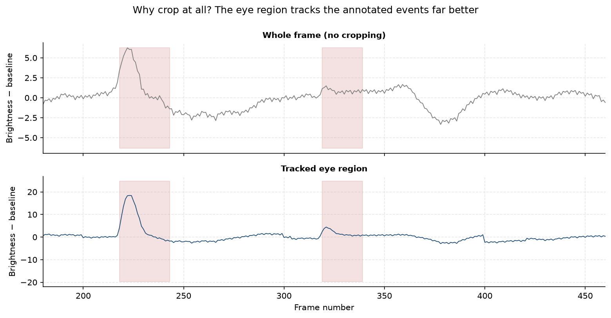

| 信号 | 帧级 AUC | 帧级 F1 |
|---|---|---|
| 全帧平均亮度 | 0.524 | 0.371 |
| 跟踪后的眼区 | **0.669** | **0.536** |

全帧亮度几乎等于随机（0.524）——整段画面里绝大部分亮度变化（云、反光、曝光）与
眨眼无关。裁出眼区后信噪比显著提高。课程"先裁剪再分析"的做法被量化验证了。

图中还藏着一个细节：眼区曲线在第 400 帧有一个不该有的台阶——那是跟踪器第 4 次更新
（每 100 帧一次）的位置，框跳了一下。**这是 `frame_step` 的代价之一：它把跟踪器的
离散更新点直接写进了信号。** 如果下游要用信号的绝对值（而不只是局部峰），
这些台阶必须先处理掉。

---

## 5. 三个方法学教训

复现之外，本项目最有价值的部分可以压缩成三句话：

**（一）分折方式决定结论。**
同一模型、同一数据，随机分折 0.806、分组分折 0.758。差距不来自模型，来自"测试集
里有没有和训练集同源的样本"。任何涉及个体的数据（患者、动物、受试者、设备）都必须
用分组交叉验证，否则报出的是"同一个体内部"的性能，而不是"新个体上"的性能。

**（二）评价口径决定结论。**
同一信号，帧级 F1 0.54、事件级 F1 0.77。差 23 个百分点，全部来自"错一帧"和
"错一次眨眼"的权重不同。做实验前必须先回答：**最终使用者关心的是哪一件事？**
答案决定了指标、阈值、以及"成功"的定义。

**（三）方法的隐含假设必须和数据形态匹配。**
滚动中位数赢过 Savitzky-Golay 和 Butterworth，不是因为更简单，而是因为它的假设
（趋势缓变、事件短促）成立。差分方法最差，因为它把"0.5 秒的平台"变成"两个尖峰"，
与区间标注天然冲突。同理，CSRT 每帧更新会失败，是因为眨眼会让它的外观模型自我污染。

---

## 6. 局限与后续工作

### 6.1 局限

1. **视频结论只来自一个个体。** M-006，1841 帧，12 次眨眼。样本量太小，无法给出
   置信区间，换个体/光照/相机，绝对值都会变。文中所有"0.67""0.77"都应理解为
   **这次测量的值**，不是这个方法的性能。
2. **阈值是在真值上调出来的。** 属于样本内结果，真实部署会更低。严格做法要留一段
   视频完全不参与调参（leave-one-video-out）。
3. **真值本身有主观性。** 全/半眨眼的边界是人的判断，构成标签噪声的上限。即使信号
   完美，也无法超过标注者之间的一致性。
4. **分类部分与视频部分没有打通。** `blink_events.csv` 不含帧号，无法把视频信号与
   具体事件的标签对上。这是最值得补的一环，但需要原始标注文件（含帧号）。
5. **跟踪漂移的结论只有一次运行。** 4.6 节的漂移数字在 step=10/50/100 之间几乎相同，
   说明漂移主要由开头几帧决定；可靠结论只有"每帧更新会失控"这一条。

### 6.2 后续工作（按性价比排序）

| 优先级 | 工作 | 预期收益 |
|---|---|---|
| 高 | 把视频管线跑遍 19 段视频 / 4 匹马，报告跨个体均值与方差 | 把"单例观察"变成"可推广的结论" |
| 高 | 拿到含帧号的原始标注，打通"信号 ↔ 事件标签" | 可以用视频信号预测全/半，而不是两条平行的分析 |
| 高 | 缩短 ROI（去掉下半区），或用暗像素占比替代均值 | 预期 AUC 从 0.67 提升到 0.75+ |
| 中 | 引入眼睑关键点（landmark）位移，替代亮度代理 | 直接测量"闭合程度"，绕开光照问题 |
| 中 | 对"低置信度 + 反复判错"的样本做二次标注 | 提高标签一致性，同时验证 3.8 节的假设 |
| 低 | 尝试按视频分组的 leave-one-video-out 评估 | 更诚实的泛化估计 |

---

## 7. 附：文件与结果索引

| 结论 | 出处 |
|---|---|
| 12 项复现对照 | `notebooks/01_session1_ml.ipynb` 末节；本报告 2.2 |
| 单特征 AUC / 重叠系数 | `outputs/t2_feature_separability.csv` |
| 深度扫描 / 树复杂度 | `outputs/t3_depth_sweep.csv`、`t4_tree_complexity.csv` |
| 网格搜索 60 组 | `outputs/t5_forest_grid.csv` |
| 重复 10 次预测明细 | `outputs/t7_repeated_predictions.csv` |
| 反复判错事件 | `outputs/t9_consistently_misclassified.csv` |
| 视频逐帧亮度 | `outputs/frame_brightness_stats.csv` |
| 逐帧 ROI 统计量 | `outputs/roi_signal_stats.csv` |
| 六模型六指标 | `outputs/e1_model_comparison.csv` |
| 分组 CV / 置换 / 嵌套 | `outputs/e2_grouped_cv.csv`、`e3_permutation_test.csv`、`e4_nested_cv.csv` |
| 特征集 / 重要性 / 学习曲线 | `outputs/e5_feature_sets.csv`、`e6_permutation_importance.csv`、`e7_learning_curve.csv` |
| 统计量 / 窗口 / 去趋势 | `outputs/s1_…`、`s2_…`、`s3_…` |
| 阈值口径 / 平滑 / 跟踪 / ROI | `outputs/s7_threshold_criterion.csv`、`s4_…`、`s5_…`、`s6_…` |

复现环境：Python 3.13、numpy 2.2.6、pandas 3.1.0、scikit-learn 1.9.1、
matplotlib 3.11.2、opencv-contrib 5.0.0。
